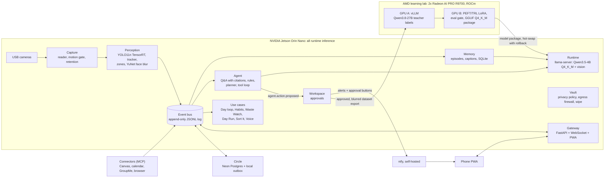

# Atlas

**Your cameras record. Atlas remembers.**

Atlas is a private AI box with eyes. It sits on your desk, sees your space, remembers it, answers
questions about it in plain English, and helps with your day. Everything it does at runtime happens on
an NVIDIA Jetson Orin Nano, so no video leaves the room. When it needs a new skill, a big open model on
two AMD Radeon AI PRO R9700s teaches it, and the smaller, smarter model is shipped back to the box.

Atlas is **one everyday tool**. Finding your keys, the package alert, the study plan before an exam, the
Circle of friends' Atlases, Waste Watch and Day Run are all use cases of the same box: the same cameras,
the same memory, the same agent and the same approvals, pointed at a different part of your life.

Built at Knight Hacks 2026 by Dominick Dupuy, Hemdutt Rao, Xander Robbins and Ilan Danial.

## What it does

- **Sees and remembers.** Detection, tracking, zones and face blur run on the Jetson. Faces are blurred
  before anything is stored. What it sees is grouped into episodes on an append-only event log.
- **Answers with evidence.** "What happened at our table overnight?" "Where are my keys?" Every answer
  cites the episode, keyframe or link it came from, and says so when Atlas did not see something.
- **Watches for you.** Rules in YAML or plain English ("tell me if a package is left at the door") are
  checked on event time, so alerts work offline. Your phone gets the alert with its blurred photo.
- **Acts only with consent.** Anything with an outside effect (a message, a calendar invite, a data
  export) becomes an approval card on your phone first.
- **Knows your week.** Connectors (each an MCP server) read Canvas, your calendar, group chats, the
  Knight Hacks site and the web. Before an exam it writes a cited plan and offers the study blocks as invites.
- **Plans with friends.** Atlases in a Circle agree on a time through Neon Postgres; only free or busy
  leaves each box.
- **Learns new skills.** You teach a task on the phone and approve the export of blurred examples.
  Qwen3.8-27B on one R9700 labels them, a LoRA fine-tune of the Jetson's Qwen runs on the other, an eval
  gate decides, and the winning model is quantized and hot-swapped onto the box.
- **Works unplugged.** `make offline` cuts the internet. Seeing, remembering, alerting and answering
  carry on; only learning, connectors and the Circle pause.

## Architecture



The rules that keep it safe to change while it runs:

- **The event log is the source of truth.** State is rebuilt by replaying it. Handlers that send,
  write or call a model are live-only, so a replay never resends a message.
- **Bounded contexts** (`contexts/<name>/`) talk only through events in `contracts/` and small APIs.
- **One `Runtime` interface** hides every model; `config/models.yaml` picks them.
- **The lab is never in the request path.** The box and the lab share two file formats, a dataset
  export and a model package, and the export only happens after an approval tap.

## Measured so far

| What | Number | Where it came from |
| --- | --- | --- |
| Detector, YOLO11n TensorRT FP16 on the Orin Nano | 41 FPS | `jetson/bench_detector.py` |
| Whole pipeline, 30-minute soak with a video as the camera | 15 fps, 0 errors | Jetson soak test |
| On-device Qwen3.5-4B Q4_K_M decode | 13 to 14 tok/s | llama-server on the Jetson |
| Demo questions, 42 phrasings of 7 questions | 42/42 correct, 0.6 to 3.3 s | `python -m contexts.agent.eval` on the Jetson |
| Teacher, Qwen3.8-27B on vLLM, one R9700 | 7.7 tok/s at 200 W average | `lab/refine/metrics.jsonl` |
| Trainer smoke LoRA run (a pipeline check, not a learned task) | loss 2.23 to 0.16 | `lab/refine/metrics.jsonl` |
| First learned task: before vs after vs teacher | pending | the first real fine-tune has not run yet |

`python lab/slide_numbers.py --gateway http://<jetson>:8000` prints every number with the row it came
from, when it was measured, and a low-confidence flag.

## Run it

On a laptop, with no models (a fake runtime gives deterministic answers):

```
python -m venv .venv && . .venv/bin/activate   # Windows: .venv\Scripts\activate
pip install -e ".[dev]"
pytest -q
python -m contexts.demo seed --now      # the demo night, published through the real app
python -m contexts.gateway              # then open http://127.0.0.1:8000
```

On the box: `jetson/README.md` (connecting and setup), `jetson/jetson_setup.sh` (the always-on
services), then before a demo:

```
python -m contexts.demo preflight --gateway http://<jetson>:8000 --reset
make offline    # and make online afterwards
```

The lab side (teacher, trainer, packaging) is in `lab/README.md`.

## Repository map

```
contracts/   shared Pydantic events and API shapes
bus/         in-process event bus + durable JSONL log
runtime/     the only way to call a model: llama-server, registry, hot-swap with rollback
contexts/    one folder per bounded context:
             capture perception memory agent workspace vault connectors learning telemetry
             circle habits day play impact profiles voice demo gateway
web/         the phone PWA and the operator screen (Next.js, served by the Jetson)
lab/         R9700 side: teacher, trainer, dataset reader, packaging, benchmarks
jetson/      setup, systemd services, egress firewall, model swap
config/      models.yaml, zones, rules, connectors, .env.example
fixtures/    sample episodes, datasets and the seeded demo night
```

## Built vs reused

**Reused:** the open models (Qwen3.5-4B, Qwen3.8-27B, YOLO11n, YuNet), ultralytics, TensorRT,
llama.cpp, vLLM, PyTorch, PEFT and TRL, FastAPI, Next.js, Neon, Tailscale, ntfy, patchright.

**Built:** the capture and perception pipeline, the event log and Memory, the agent (Q&A with
citations, rules, planner), approvals, the connectors, the privacy vault and egress firewall, the
learning loop (export, labeling, LoRA training, eval gate, packaging, hot-swap), the Circle protocol,
the use cases on top, and the phone app.

## How we built it

Four people, each working with an AI coding agent (Claude Code and others), in parallel overnight.
Notion was the team's source of truth: a task board where each task has a lock that one agent holds at a
time, a Team Comms page per person where agents ask and answer each other's questions, a build log, and
an overnight status page that people read in the morning. [`AGENTS.md`](AGENTS.md) is the rulebook every
agent follows. All work landed through feature branches and pull requests with tests green.

## Contributing

**Using an AI coding agent on this repo? Read [AGENTS.md](AGENTS.md) first.** Notion is the source of
truth and the team's communication channel. Branches are `ctx/<context>/<feature>`; contexts talk only
through events in `contracts/`; never call a model directly, go through `runtime/`.
